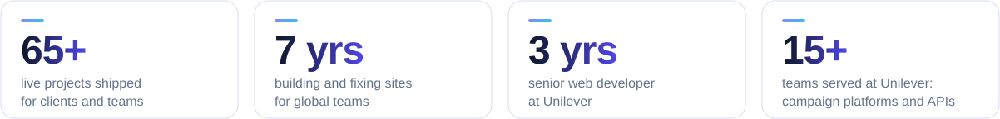
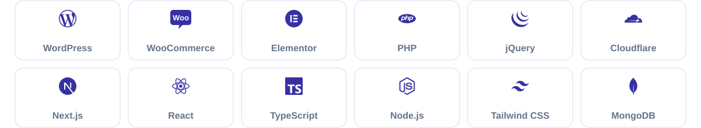

  <picture>
    <source media="(prefers-color-scheme: dark) and (max-width: 640px)" srcset="assets/banner-narrow-dark.svg">
    <source media="(max-width: 640px)" srcset="assets/banner-narrow-light.svg">
    <source media="(prefers-color-scheme: dark)" srcset="assets/banner-dark.svg">
    
  </picture>

 

**I fix, speed up and modernize the websites businesses depend on.**

Seven years of fixing slow sites and building ones that last. Three of them at Unilever, shipping campaign platforms and APIs for 15+ teams. The rest delivering bilingual and multilingual sites for clients worldwide.

I work with marketing teams, growing businesses and agencies on sites that are slow, hard to edit or outgrowing WordPress, and I will tell you honestly when a rebuild is cheaper than a fix.

  <picture>
    <source media="(prefers-color-scheme: dark) and (max-width: 640px)" srcset="assets/stats-narrow-dark.svg">
    <source media="(max-width: 640px)" srcset="assets/stats-narrow-light.svg">
    <source media="(prefers-color-scheme: dark)" srcset="assets/stats-dark.svg">
    
  </picture>

## What I do

<table>
  <tr>
    <td width="50%" valign="top"><b>Improve</b> Fix and speed up the site you already have. Technical assessment, performance and Core Web Vitals, maintenance, site takeovers.</td>
    <td width="50%" valign="top"><b>Build</b> New sites and stores, built to last. Custom WordPress, WooCommerce stores, React and Next.js projects.</td>
  </tr>
  <tr>
    <td width="50%" valign="top"><b>Modernize</b> Outgrown the old site? Redesign, replatform or go headless. WordPress to Next.js migrations included.</td>
    <td width="50%" valign="top"><b>Partner</b> Senior capacity for agencies and in-house teams. White-label delivery under your brand.</td>
  </tr>
</table>

## Stack

  <picture>
    <source media="(prefers-color-scheme: dark) and (max-width: 640px)" srcset="assets/stack-narrow-dark.svg">
    <source media="(max-width: 640px)" srcset="assets/stack-narrow-light.svg">
    <source media="(prefers-color-scheme: dark)" srcset="assets/stack-dark.svg">
    
  </picture>

## Open-source work

Most of my client work is private, so these are the public repos that show how I build.

- [**job-catch**](https://github.com/amr99osama/job-catch): a MERN job-listing dashboard. React with React Router and React Query, Recharts stats, and an Express and MongoDB API with JWT auth, request validation, rate limiting, Helmet and Cloudinary image uploads.
- [**Amana**](https://github.com/amr99osama/Amana): a React Native and Expo mobile app for lost and found items, with image-upload posts, matching posts, comments, notifications, JWT auth and an admin panel.
- [**comfort-store**](https://github.com/amr99osama/comfort-store): a React 18 storefront with Redux Toolkit, React Query 5 and DaisyUI. [Live demo](https://comfort-ecomm.netlify.app/).

## Let's talk

  

  <a href="https://amr-osama.net/">Website</a> ·
  <a href="mailto:connect@amr-osama.net">connect@amr-osama.net</a> ·
  <a href="https://www.linkedin.com/in/amrosama99/">LinkedIn</a> ·
  <a href="https://www.upwork.com/freelancers/~01db6f1accf32578ee">Upwork</a> ·
  <a href="https://dev.to/amr_osama99">DEV</a>

Based in Cairo, working with teams worldwide. I reply within one business day.

